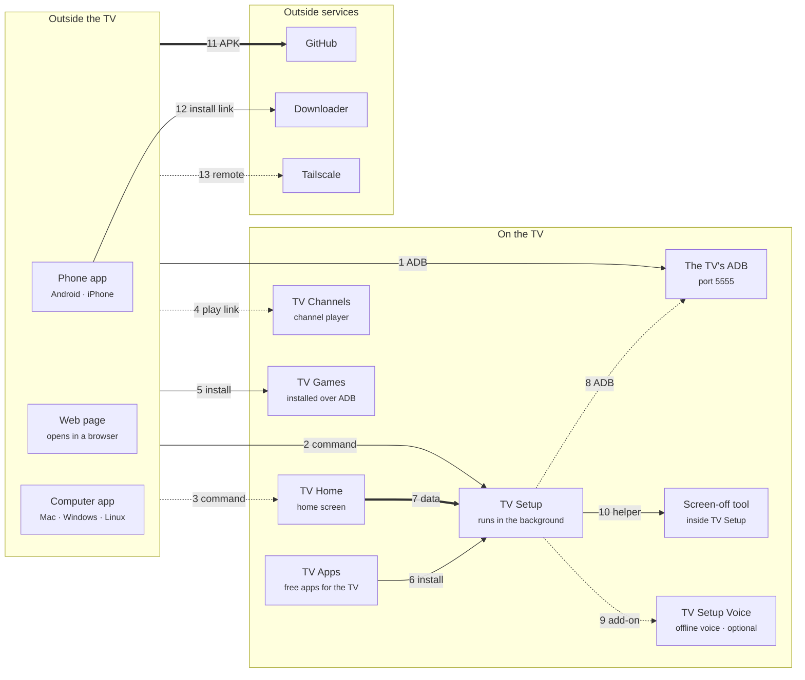

> **Shelby+ Remote — Your TV. Your Control.** Fork setup, APK artifacts, iPhone installation and validation limits: [SHELBY.md](SHELBY.md).

## Shelby+ production releases and updates

Production releases are manual and use the existing protected `shelby-release` environment and permanent signing key. **Do not change or regenerate that key.** Read [SIGNING.md](SIGNING.md) for signing, migration and recovery details. Permanent readiness passed in [run #13](https://github.com/muhdkhairulazhary-ai/shelby-plus-remote/actions/runs/43745151825); this PR does not publish an APK.

1. Review and merge the release changes to `main`. Set `app/tvsetup/VERSION` and `.github/release-notes/shelby-tv.md` in a reviewed PR. Versions use `major.minor.patch` (each 0–99); Android versionCode is `100000 + major*10000 + minor*100 + patch`. Every production release must increase it. The app and add-on package IDs stay unchanged.
2. On GitHub, open **Actions → Shelby+ Remote TV Release → Run workflow**, select **main** and enter the exact committed version (this change prepares **0.53.2**, code **105302**). Approve the protected environment when requested. The workflow checks public release history/tags, web/Kotlin/lint/browser/TV-server tests, permanent certificate, both APK signatures, add-on signer and MIT notice. It creates `shelby-tv-v<VERSION>-1`; existing tags/releases are never overwritten. Ordinary pushes and PRs only validate.
3. For the first permanent release, review the one-time temporary-key migration and set the existing environment variable `SHELBY_INITIAL_MIGRATION_APPROVED=true` only if accepting that migration. Remove it afterward. A changed signer after a production release is always rejected. Keep all existing signing secrets and `SHELBY_RELEASE_CERT_SHA256` unchanged.
4. Download **shelby-plus-remote-tv.apk** from the completed Release, with public certificate, checksum, installation/migration notes and `shelby-update.json`. Validation Actions ZIPs are for fresh test installs and cannot provide production updates.

On Android TV, open Downloader with the physical remote and enter:
`https://github.com/muhdkhairulazhary-ai/shelby-plus-remote/releases/latest/download/shelby-plus-remote-tv.apk`

That address currently follows the previous published release; it will serve the production APK only after a production release is published. No Downloader numeric code is assigned. Install the APK, open Shelby+ Remote, then open the TV-displayed address (port 8765) in iPhone Safari on the same trusted Wi-Fi and pair.

For later updates, open the Shelby+ Remote banner on the TV, choose **Check for updates**, read current/available versions and notes, then choose Update. If required, Android opens this app's installation permission screen; after returning, confirm again. The verified APK goes to Android's installer, which asks before installation. Same-package, same-key updates keep pairing/settings; **do not uninstall or clear data**. Safari retains authentication when its TV address/origin and browser storage remain the same.

If Wi-Fi, storage, verification or installation fails, the existing app stays installed. Free space/check Wi-Fi and retry, or download the verified tagged APK through Downloader. A faulty installed release needs a corrected, higher-version APK signed with the same key; a lower-version APK is not an in-place rollback. Installer failures are shown on return or the next app opening. Old temporary-key builds need a one-time fresh installation and re-pairing; uninstalling loses their private state.

**iPhone-only workflow:** in Safari sign into GitHub, use the repository Actions tab (Request Desktop Website if controls are hidden), run the reviewed main workflow with its version, approve `shelby-release`, and wait for a successful run. Open Releases to read compatibility notes and copy the stable or tagged APK URL. Enter that URL in Downloader using the TV remote. No computer or iPhone APK installation is required. Approving a signing environment can require a separate permitted reviewer.

Keep encrypted offline backups of the permanent keystore and recovery passwords in separate secure locations; GitHub secrets are not a recoverable backup. Never upload a keystore/password/Base64 secret to a release, issue or git. If the key is lost, future same-key updates cannot be signed. If compromised, stop releases and plan a deliberate migration; this updater rejects certificate rotation. See [SIGNING.md](SIGNING.md).

<h1 align="center">TV Remote</h1>

  <b>Take back your Android TV: a home screen with no ads, the bloat switched off, the remote on your phone or computer.</b> 
  Android TV / Google TV · LG · Samsung · Roku · VIDAA &nbsp;·&nbsp; no root &nbsp;·&nbsp; no account &nbsp;·&nbsp; every change undoable

  <a href="#get-it">Get it</a> ·
  <a href="#quick-start">Quick start</a> ·
  <a href="#features">Features</a> ·
  <a href="#more-apps-for-the-tv">More apps</a> ·
  <a href="https://tvremote.pages.dev/guide?lang=en">User guide</a> ·
  <a href="CHANGELOG.md">Changelog</a> ·
  <a href="README.vi.md">Tiếng Việt</a>

  
  
  
  
  

<table>
<tr>
<td align="center"> Phone app</td>
<td align="center"> TV web page</td>
<td align="center"> Computer app</td>
</tr>
</table>

Everything goes straight from your device to the TV: no cloud, no sign-up. Every feature with screenshots: [tvremote.pages.dev](https://tvremote.pages.dev/?lang=en).

> **Also by the author:** [KidGuard](https://github.com/HoangTran0410/kidguard) manages your child's Android phone from any browser: time limits, app blocking, bedtime, location. One APK, no account, free. [kid-guard.pages.dev](https://kid-guard.pages.dev/en/)

## Get it

| You have | Use | Download | Downloader code |
|---|---|---|---|
| An Android phone | **Phone app** (*TV Remote*) | [tv-remote.apk](https://github.com/HoangTran0410/tv-remote/releases/latest/download/tv-remote.apk) | **`2973135`** |
| An iPhone, or any browser | **TV web page**: install the **TV app** (*TV Setup*) on the TV, open `http://<TV IP>:8765` | [tv-setup.apk](https://github.com/HoangTran0410/tv-remote/releases/latest/download/tv-setup.apk) | **`2397346`** |
| A Mac | **Computer app** (*TV Remote*, about 35 MB) | [TV-Remote-mac.zip](https://github.com/HoangTran0410/tv-remote/releases/latest/download/TV-Remote-mac.zip) | |
| Windows 10 / 11 | **Computer app** | [TV-Remote-windows-x64.zip](https://github.com/HoangTran0410/tv-remote/releases/latest/download/TV-Remote-windows-x64.zip) | |
| Linux | **Computer app** | [x64](https://github.com/HoangTran0410/tv-remote/releases/latest/download/TV-Remote-linux-x64.tar.gz) · [arm64](https://github.com/HoangTran0410/tv-remote/releases/latest/download/TV-Remote-linux-arm64.tar.gz) | |
| Optional, on the TV | TV Home · TV Channels · TV Games · TV Apps | [tv-home.apk](https://github.com/HoangTran0410/tv-remote/releases/latest/download/tv-home.apk) · [tv-channels.apk](https://github.com/HoangTran0410/tv-remote/releases/latest/download/tv-channels.apk) · [tv-games.apk](https://github.com/HoangTran0410/tv-remote/releases/latest/download/tv-games.apk) · [tv-apps.apk](https://github.com/HoangTran0410/tv-remote/releases/latest/download/tv-apps.apk) | **`4356026`** · **`8135635`** · **`2294968`** · **`1082201`** |

Automatic updates for the phone app: [Obtainium](https://apps.obtainium.imranr.dev/redirect?r=obtainium://app/%7B%22id%22%3A%22dev.tvremote.phone%22%2C%22url%22%3A%22https%3A%2F%2Fgithub.com%2FHoangTran0410%2Ftv-remote%22%2C%22author%22%3A%22HoangTran0410%22%2C%22name%22%3A%22TV%20Remote%22%2C%22additionalSettings%22%3A%22%7B%5C%22apkFilterRegEx%5C%22%3A%20%5C%22%5Etv-remote%5C%5C%5C%5C.apk%24%5C%22%2C%20%5C%22releaseDateAsVersion%5C%22%3A%20true%2C%20%5C%22includePrereleases%5C%22%3A%20false%7D%22%7D) (tracks only `tv-remote.apk`). A TV or box that worked, or did not? A [device report](https://github.com/HoangTran0410/tv-remote/issues/new?template=device_report.yml) helps.

Codes go in the **Downloader** app on the TV and always point at the latest release. No Downloader: type `tvremote.pages.dev/dl/tv-setup.apk` in the TV's browser (any file above: `/dl/<name>`). *tv-voice.apk* (speech heard on the TV itself, Vietnamese, 39 MB) and *tv-voice-en.apk* (English, 47 MB, for TV Setup in any other language) have no code: TV Setup installs the one for its language when you turn on "Understand speech on the TV itself" (Setup tab, Remote buttons card) and removes it when you turn it off.

## Quick start

1. **Open the app** and pick the TV ([phone](https://tvremote.pages.dev/guide?lang=en#install-phone) · [computer](https://tvremote.pages.dev/guide?lang=en#install-pc) · [iPhone / browser](https://tvremote.pages.dev/guide?lang=en#web-iphone): install [TV Setup](https://tvremote.pages.dev/guide?lang=en#install-tv), scan its QR).
2. **Type the code the TV shows**: the keys work at once, with ADB off ([keys before ADB](https://tvremote.pages.dev/guide?lang=en#nokeys)).
3. **Later, for the screen, apps and files: turn on ADB** (optional). Easiest: [install TV Setup](https://tvremote.pages.dev/guide?lang=en#install-tv) and press "Turn ADB on for me". By hand: Settings → About → press OK on **Build** 7 times → Developer options → **ADB debugging** ([step by step](https://tvremote.pages.dev/guide?lang=en#prep-tv)); never on a provider box (FPT, Viettel…): it may ask for a password or lock up. Then choose "Always allow" on [Allow USB debugging?](https://tvremote.pages.dev/guide?lang=en#allow-usb)

## Features

| Feature | What it does | Guide |
|---|---|---|
| 🎮 **Remote** | Arrows, volume, channels, apps, typing, voice; holds keys like the real remote; a Simple remote of big keys for grandparents | [→](https://tvremote.pages.dev/guide?lang=en#remote) |
| 📺 **The TV's picture** | On your device, with touch and sound; listen with the phone's screen off | [→](https://tvremote.pages.dev/guide?lang=en#picture) |
| ✏️ **On the TV's screen** | Draw, send a photo, a video or your camera, or a message; now playing; the TV's clipboard; dim or blue light filter | [→](https://tvremote.pages.dev/guide?lang=en#draw) |
| 🔒 **For kids** | Sleep timer, bedtime, app limits, volume limits, PIN-locked apps and TV Home layout: they run on the TV itself | [→](https://tvremote.pages.dev/guide?lang=en#limits) |
| 📱 **Manage the TV** | Apps, files, health (memory, the TV's own internet speed), several TVs at once | [→](https://tvremote.pages.dev/guide?lang=en#apps) |
| ⚡ **Optimize TV** | Faster and lighter: animations off, ad-filled home screen and unused apps paused; **Undo** puts it all back | [→](https://tvremote.pages.dev/guide?lang=en#optimize) |
| 🏠 **Launcher gallery** | Pick a home screen without ads (TV Home first, then others) and install it in one tap; the old one goes off only once the new one answers Home | [→](https://tvremote.pages.dev/guide?lang=en#launchers) |
| 🛡️ **DNS filter** | Blocks ads and malware for every app through Private DNS; checks names still work within 30 s, else puts the old setting back; turns itself off if it breaks later | [→](https://tvremote.pages.dev/guide?lang=en#tvguard) |
| 🧹 **Clean caches** | Frees space from every app's cache; app data and sign-ins stay | [→](https://tvremote.pages.dev/guide?lang=en#apps) |
| 🔑 **Who may control the TV** | Each browser pairs once with a 6-digit code; the Setup tab lists the paired devices, forget one or all. the Setup tab's **Who may use ADB** lists the keys the TV allows and who is connected, and can revoke all (it asks first). "Allow USB debugging?" is answered for our own key; another device's only when you pick Allow or Decline | [→](https://tvremote.pages.dev/guide?lang=en#share) |
| ⌨️ **Test remote keys** | Every key the TV gets, live: name, code, which remote, press or hold, remapped or not | [→](https://tvremote.pages.dev/guide?lang=en#keyfix) |
| 🎬 **Scenes and links** | Several steps in one tap, widget, Quick Settings tiles, Home Assistant, Siri Shortcuts, your own Telegram bot | [→](https://tvremote.pages.dev/guide?lang=en#scenes) |
| 🌍 **Away from home** | Through Tailscale, set up with one button, nothing typed on the TV | [→](https://tvremote.pages.dev/guide?lang=en#away) |
| 📡 **Other brands** | LG, Samsung, Roku, VIDAA (beta): keys, typing, apps, power on, scenes | [→](https://tvremote.pages.dev/guide?lang=en#brands) |

<b>What each app can do</b>

**Phone app** and **Computer app** (both *TV Remote*), **TV app** (*TV Setup* on the TV), **TV web page** (what TV Setup serves on port 8765, any browser after a 6-digit code; also on the TV as *Manage on this TV*).

| | Phone app | TV web page | Computer app |
|---|---|---|---|
| Remote, the TV's picture and touch, draw, picture or message on the TV | ✓ | ✓ | ✓ |
| Video over every app in a box you move and resize: a file, or your camera | ✓ | ✓ (file only) | ✓ |
| Now playing, the TV's clipboard, screen off while it keeps playing, dim the screen | ✓ | ✓ | ✓ |
| Volume limits by time of day, sleep timer, bedtime, app limits, PIN lock | ✓ | ✓ | ✓ |
| Listen to the TV | ✓, screen off too | ✓, while the page is open | ✓, high quality |
| Apps, Files, Health, Automation, Setup | ✓ | ✓ | ✓ |
| *Sharpest* picture quality | | | ✓ |
| Several TVs | ✓ | only that TV | ✓ |
| Turn on a TV that is fully off (Wake-on-LAN) | ✓ | | ✓ |
| Keys before the TV has allowed ADB | ✓ | | ✓ |
| Infrared remote (phone's IR blaster, no network) | ✓ | | |
| Widget, Quick Settings tiles, the phone's volume keys, a remote in notifications and on the lock screen | ✓ | | |
| Game controller | ✓ | ✓ | ✓ |
| Link for Home Assistant, Shortcuts (Siri) | | ✓ | ✓ |
| Telegram bot | needs TV Setup | set up here | needs TV Setup |
| Nothing to install on the controlling device | | ✓ | |
| LG, Samsung, Roku, VIDAA TVs | ✓ | | ✓ |

## More apps for the TV

Free, no ads, each on its own: install from the phone or computer app (TV tab), or with the Downloader codes above.

<table>
<tr>
<td align="center" width="50%"> Before: Google TV's home screen</td>
<td align="center" width="50%"> After: TV Home</td>
</tr>
</table>

| App | What it is | Guide |
|---|---|---|
| 🏠 **TV Home** | A home screen with no ads and no suggested rows (0.2 MB): your apps, widgets, wallpapers, themes, YouTube channels and videos pinned from a link, set up from the phone | [→](https://tvremote.pages.dev/guide?lang=en#home) |
| 📺 **TV Channels** | Free TV channels from everywhere (iptv-org, VieON), programme guide, reminders, favourites | [→](https://tvremote.pages.dev/guide?lang=en#channels) |
| 🎮 **TV Games** | Retro and web games, up to 4 phones as pads; card and board games with each hand on its own phone | [→](https://tvremote.pages.dev/guide?lang=en#games) |
| 📦 **TV Apps** | Free, open-source TV apps (SmartTube, Kodi, VLC, Jellyfin…), each checked against its maker's signature, one press to install | [→](https://tvremote.pages.dev/guide?lang=en#tvapps) |

<b>How the apps fit together</b>

Each arrow is a link between two apps. Solid: the app tells you what is missing; dashed: only partly; thick: it stays quiet. With logos and a table of every link: [tvremote.pages.dev/apps](https://tvremote.pages.dev/apps).

<!-- apps-map:start -->

<!-- apps-map:end -->

## Tested on

| Kind | Brands | Source |
|---|---|---|
| TVs | Sony BRAVIA (Android 9) | tested by us |
| TVs | TCL, Xiaomi / Mi TV, Hisense (Google TV), Philips (Google TV), OnePlus, BenQ, CHiQ, RCA, SANYO, Toshiba, Insignia, Thomson | owners ([cleanyourtv](https://github.com/Gathin23/cleanyourtv)) |
| Boxes | Chromecast with Google TV, NVIDIA Shield, Mi Box S, Mi TV Stick, Fire TV (Optimize TV cannot change Home) | owners |
| Projectors | XGIMI, Epson | owners |
| Other brands | LG, Samsung, Roku, VIDAA | beta, not tested on a real TV |

### Where Optimize TV's lists come from

| Source | What it adds |
|---|---|
| [cleanyourtv](https://github.com/Gathin23/cleanyourtv) (MIT), its forks, PRs and issues | the per-TV lists of 400+ TVs, each from its owner, and what broke on which TV |
| [UAD-NG](https://github.com/Universal-Debloater-Alliance/universal-android-debloater-next-generation), [TV Slim](https://github.com/jolabs40/TVSlim) | risk notes and never-touch lists |
| TV Remote's users | GitHub issues, logs sent from the app, our own TVs (Sony BRAVIA, FPT Play box) |

Read again every few days (last: 2026-11-02). What was taken, what was left out and why: [dev/sign/bloat-sources.md](dev/sign/bloat-sources.md). Only apps that are off on many TVs and kept on none are suggested; anything someone lost a feature to goes on the keep list. The list is signed and read from the site each time Optimize TV opens, so no update is needed.

**Safety rules** (`core/ontv/Setup.kt`, `LauncherSwap.kt`, `Bloat.kt`):

| Rule | How |
|---|---|
| Turns off, never uninstalls | `pm disable-user`: nothing is deleted, any app comes back |
| Never touches what the TV needs | a protected list (Google's core, keyboards, setup, TV Setup itself) plus each brand's keep list, which nothing can override; and, checked on the TV before each change, any app that owns the HDMI / tuner inputs, a saved Wi-Fi network or the Settings screen, or that Android keeps running. The Apps tab refuses them too |
| Records before it changes | what it turned off is written on the TV, and offered as a restore script that needs only `adb` |
| New home screen first | the new launcher must open and answer Home before the old one goes off; if not, it rolls back |
| Undo turns back on only its own | what the record names and its suggested list, nothing you turned off yourself |
| After a firmware update | turns off again what the update turned back on; Undo stops that |
| Remote keys | Input / app keys the old launcher handled keep working: TV Setup takes them over |

## Help

| Need | Go to |
|---|---|
| Something does not work | [Troubleshooting](https://tvremote.pages.dev/guide?lang=en#faq-fix) · the app's own check names the cause and the fix |
| The TV asks "Allow USB debugging?" again | [Why and what to do](https://tvremote.pages.dev/guide?lang=en#allow-usb) |
| Every topic, with search | [User guide](https://tvremote.pages.dev/guide?lang=en) |
| A bug or an idea | [Issues](https://github.com/HoangTran0410/tv-remote/issues) |

**Security:** ADB over the network has no password, so use it on networks you trust and Tailscale away from home. **Never open port 8765 to the Internet.** Only a device paired with the code shown on the TV, or one the TV already allowed, can control it; **Unpair all** in TV Setup takes every one back.

**Privacy:** one anonymous note a day (TV model, Android and app version, what worked) and app errors with IPs, names and keys removed; never your IP, apps, account or Wi-Fi name. Off in Settings → Send anonymous stats. [Details](https://tvremote.pages.dev/guide?lang=en#privacy).

## For developers

Code names, layout, rules and tests: [AGENTS.md](AGENTS.md) · how it works, build, run and test: [dev/README.md](dev/README.md) · why some code looks odd: [dev/DECISIONS.md](dev/DECISIONS.md) · the site: [docs/README.md](docs/README.md) · TV Home themes: [THEMES.md](THEMES.md).

**Add a language:** its files in `app/shared/i18n/` (copy `en.json` and `apps/en/`) plus one line in `langs.json`; no code changes. `node --test app/shared/tests/` says what is missing.

Credits: [scrcpy](https://github.com/Genymobile/scrcpy) (Apache-2.0), [JMuxer](https://github.com/samirkumardas/jmuxer) (MIT), [webview](https://github.com/webview/webview) (MIT), [JNA](https://github.com/java-native-access/jna) (Apache-2.0), [cleanyourtv](https://github.com/Gathin23/cleanyourtv) (Optimize TV's lists); the table games follow [gamehub24](https://gamehub24.pages.dev). License: [MIT](LICENSE).

<!-- aio-desktop:start -->
### 🖥️ AIO Desktop

Find this app and many more free tools & games in **[AIO Desktop](https://fbaio.org/#/desktop)**, a Windows/macOS-style web desktop by Social AIO. [▶ Open AIO Desktop](https://fbaio.org/#/desktop)
<!-- aio-desktop:end -->
